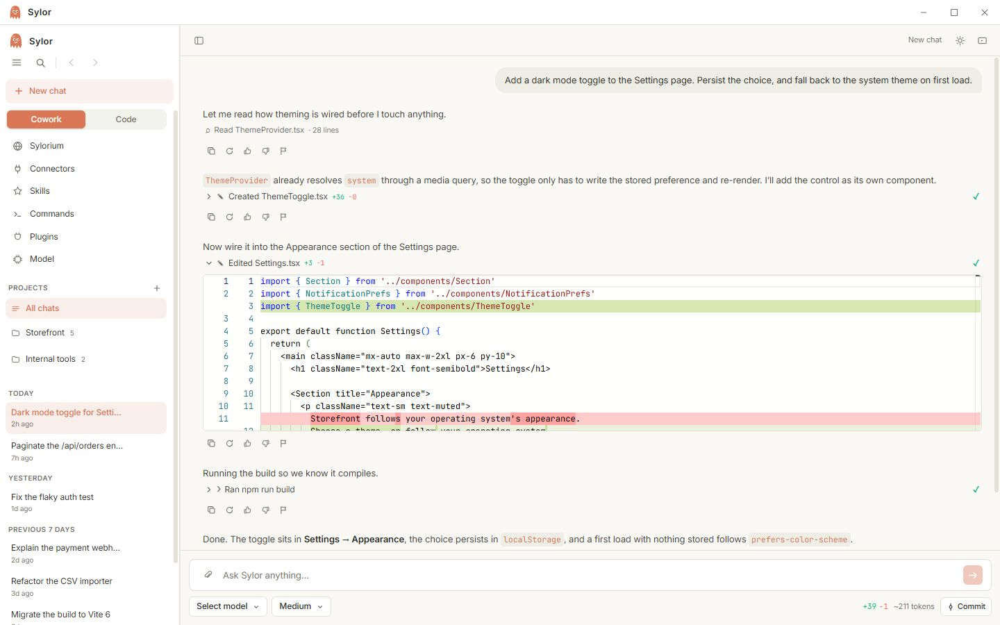
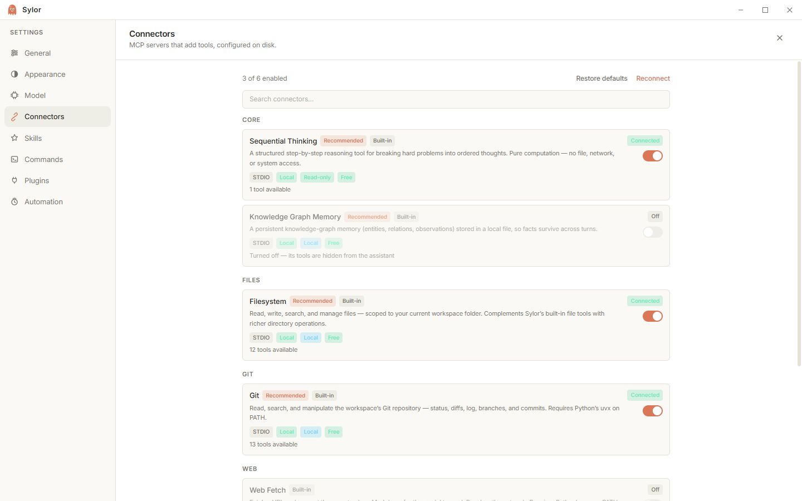
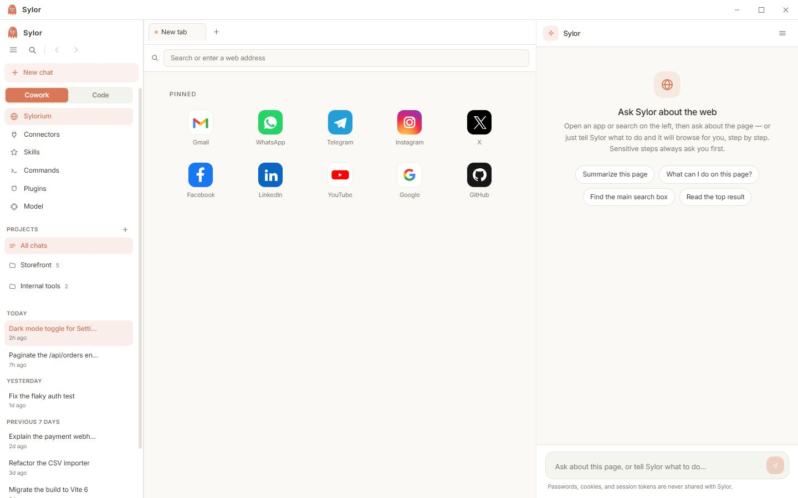

<div align="center">

# Myto

**An agentic coding workspace that lives on your machine.**
Chat, browse, and ship code with your own models — desktop, mobile, web, and terminal.

[](https://github.com/explorearafat/myto/releases/latest)
[](https://github.com/explorearafat/myto/releases/latest)
[](./LICENSE)
[](package.json)
[](package.json)
[](vitest.config.ts)
[](#-contributing)

[Website](https://mytocode.vercel.app) · [Download](https://github.com/explorearafat/myto/releases/latest) · [Changelog](https://mytocode.vercel.app/changelog) · [Guide](https://mytocode.vercel.app/guide)

</div>

---

## 🧭 What is Myto?

Myto (formerly **Sylor**) is a local-first, **bring-your-own-key** AI workspace for getting real work done. Instead of a cloud agent that peeks at your repo from someone else's servers, Myto runs next to your project: it reads your code, proposes edits for approval, runs the build, and shows you the diff — all inside one window you control.

The same idea stretches across every surface you work on. The **Windows desktop app** is the full workspace, the **Android app** is a native chat client with agent rooms and a social Discover feed, the **web build** runs with zero install, and the **`myto` CLI** brings the agent into your terminal. Sign in with email, pick any model — hosted providers or local ones through Ollama — and everything streams client-side with your keys staying yours.

## ✨ Highlights

| | |
|---|---|
| 🛠️ **Cowork** | A working session with your agent — integrated terminal, scheduled tasks, one-click **rewind**, and inline **diffs** before anything lands |
| 🌐 **Sylorium browser** | A built-in browser with pinned apps; ask Myto about any page, or let it browse for you step by step — sensitive steps always ask first |
| 🔌 **Connectors (MCP)** | Model Context Protocol servers as tools — Sequential Thinking, Knowledge Graph Memory, Filesystem, Git, Web Fetch, and more, each toggleable |
| 🤖 **Agents & rooms** | 1-to-1 specialist chats and **research rooms** where every member takes a turn, closed by a consolidated research report |
| 🧠 **Bring any model** | BYOK streaming chat — hosted providers or fully local via Ollama; the model picker is yours |
| 🔐 **Local-first auth** | Email sign-in with Firebase, Firestore-backed sync, artifacts vault that follows you across clients |
| ⚡ **Automations** | Scheduled tasks and a desktop automation pane for the repetitive parts |
| 📱 **Discover** | A social feed built into the mobile app — follow what other builders are doing |

## 🖼️ See it in action

<table>
  <tr>
    <td width="100%" align="center">
      
      <br><sub><b>Cowork</b> — reads your code, edits with approval, runs the build, shows the diff</sub>
    </td>
  </tr>
  <tr>
    <td width="100%" align="center">
      
      <br><sub><b>Connectors</b> — MCP servers as first-class tools, each one toggleable</sub>
    </td>
  </tr>
  <tr>
    <td width="100%" align="center">
      
      <br><sub><b>Sylorium</b> — browse the web with Myto riding shotgun</sub>
    </td>
  </tr>
</table>

## 📦 Install

### Windows (full workspace)

Download **`Myto-Setup.exe`** (~265 MB, v0.10.0) from the [latest release](https://github.com/explorearafat/myto/releases/latest). Windows 10/11, 64-bit.

> 🔎 The build is self-signed, so SmartScreen warns on first run — click **More info → Run anyway**.

### Android (native chat)

Grab **`myto.apk`** (~55 MB) from the [latest release](https://github.com/explorearafat/myto/releases/latest). Because the APK is self-signed, Android asks you to allow the install the first time.

### Web (zero install)

Open [**mytocode.vercel.app**](https://mytocode.vercel.app) and start chatting — no account, no download required.

### Terminal (CLI)

```bash
npm install -g mytocode
myto
```

> The npm package is `mytocode` (the bare name was too close to existing packages) — but the command it installs is `myto`. Requires **Node.js 20+**.

### Other platforms

| Platform | Status |
|---|---|
| 🪟 Windows | ✅ Available now |
| 🤖 Android | ✅ Available now |
| 🍎 iOS | 🚧 Planned — same Flutter codebase, pending App Store packaging |
| 🐧 Linux / macOS | 🚧 Built from source today (see below), packaged installers on the roadmap |

## 🚀 Getting started (first run)

1. **Launch Myto** and sign in with email — or skip straight to the model picker.
2. **Bring a key** — paste an API key from any supported provider, or point Myto at a local Ollama endpoint. Keys live client-side.
3. **Open a project** — Myto reads your workspace, proposes edits for approval, and runs builds on request.
4. **Wire up connectors** — enable the MCP servers you want (Filesystem, Git, Web Fetch…) from **Settings → Connectors**.
5. **Say hi** — ask for a change, watch the diff, hit commit.

## 🧱 Project structure

Myto is one repo with several surfaces:

```
myto/
├── app/            # Electron desktop app (main + renderer, electron-vite)
├── src/            # Marketing site + web app (React 19, Vite 6, Tailwind 4)
│   ├── server/     # API gateway, model adapters, tools, link preview
│   └── ...         # features, discover, chat, guide, use-cases pages
├── api/            # Serverless endpoints (chat, models, link-preview)
├── mobile/         # Flutter app — chat, agent rooms, Discover (Android / iOS)
├── cli/            # The `myto` terminal TUI (npm: mytocode)
├── public/         # Static assets served by the site (shots/, cli/, llms.txt)
├── authentication/ # Email auth flows (Firebase)
├── firestore.rules # Firestore security rules
├── chat/ · discover/ · community/ · guide/ · policy/   # Site sections
└── scripts/        # Build + release tooling
```

**Stack at a glance:** TypeScript · React 19 · Vite 6 · Tailwind CSS 4 · Electron · Flutter · Firebase · Vitest

## 🛠️ Development

```bash
# 1. Clone
git clone https://github.com/explorearafat/myto.git
cd myto

# 2. Install (root + desktop app)
npm install
npm run install:app

# 3. Run the web/marketing app on :3000
npm run dev

# 4. Type-check, test
npm run lint        # tsc --noEmit
npm test            # vitest run

# 5. Build the Windows desktop app + site
npm run build       # electron dist → copy → vite build
npm run build:web   # site only (with type-check)
```

The desktop app has its own electron-vite workflow:

```bash
cd app
npm run dev         # electron-vite dev
npm run dist:win    # package Windows installer
npm run dist:mac    # macOS build (also :x64 / :arm64 variants)
npm run dist:linux  # Linux build
```

## 🗺️ Roadmap

- [ ] **iOS** — App Store packaging of the existing Flutter app
- [ ] **Linux & macOS installers** — packaged releases alongside the Windows build
- [ ] **Deeper automations** — richer scheduled tasks in Cowork
- [ ] **More connectors** — growing the MCP library out of the box

## 🤝 Contributing

Issues, ideas, and pull requests are welcome! If you're touching the desktop app, please run `npm run lint` and `npm test` before opening a PR. For bigger changes, open an issue first so we can align on the approach.

## 📄 License

[MIT](./LICENSE) © 2026 Myto — built by [Eyasin Arafat](https://github.com/explorearafat).
